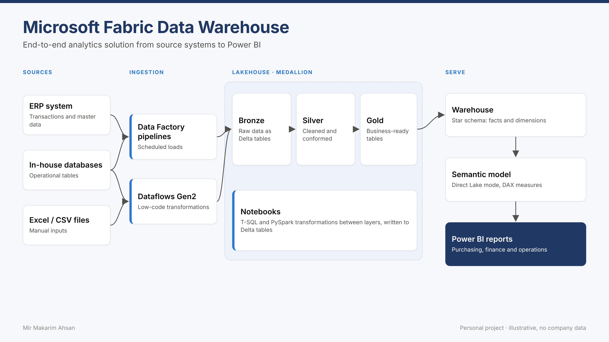

# 🧱 Microsoft Fabric Data Warehouse

**End-to-end procurement analytics on Microsoft Fabric: from raw files to a Direct Lake semantic model for Power BI.**




## The problem

Purchasing data usually sits in several places: an ERP system, in-house databases and Excel files. Reports built on top of these sources are slow, inconsistent and hard to trust. This project shows how to bring the data into one governed model in Microsoft Fabric, so every report uses the same cleaned numbers.

## What it does

| Layer | Item | What happens |
|---|---|---|
| Ingestion | `pl_procurement_daily` pipeline | Copies raw CSV files into the Lakehouse and runs the notebooks in order |
| Bronze | `01_bronze_ingest` | Loads raw files 1:1 into Delta tables, adds run metadata |
| Silver | `02_silver_transform` | Trims text, fixes types, removes duplicates, quarantines invalid rows, converts all amounts to EUR, runs data quality checks |
| Gold | `03_gold_model` | Builds a star schema: 4 dimensions, 2 facts, delivery KPIs |
| Warehouse | `dw.usp_load_star_schema` | Loads the gold tables into the Fabric Warehouse with CTAS and informational keys |
| Serve | `measures.dax` + `rpt` views | Direct Lake semantic model and SQL views for Power BI and analysts |

## Data model

```
                 dim_date
                    │
dim_supplier ── fact_po_line ── dim_material
                    │
                dim_plant            fact_invoice ── dim_date
```

| Table | Grain | Key measures |
|---|---|---|
| `fact_po_line` | one purchase order line | spend (EUR), PO cycle days, delivery delay, on-time flag |
| `fact_invoice` | one invoice | invoice amount (EUR) |
| `dim_supplier` | one supplier | category, country, payment terms, sourcing type |
| `dim_material` / `dim_plant` / `dim_date` | one row per member | descriptive attributes |

**DAX measures:** Total Spend, Spend YoY %, On-Time Delivery %, Avg PO Cycle Days, Single-Source Spend %, Active Suppliers, Invoice vs PO Variance.

## Repository structure

```
fabric-data-warehouse/
├── data/raw/                     # fictional sample data (CSV)
├── scripts/generate_sample_data.py
├── notebooks/                    # Fabric notebooks (source format)
│   ├── 01_bronze_ingest.py
│   ├── 02_silver_transform.py
│   └── 03_gold_model.py
├── warehouse/                    # Fabric Warehouse T-SQL
│   ├── 01_schema.sql
│   ├── 02_load_star_schema.sql
│   └── 03_reporting_views.sql
├── pipelines/pl_procurement_daily.json
├── semantic-model/measures.dax
└── docs/architecture.png
```

## How to run it

1. **Create the items** in a Fabric workspace: Lakehouse `lh_procurement`, Warehouse `wh_procurement`.
2. **Upload the data:** put the CSV files from `data/raw/` into the Lakehouse folder `Files/raw/`. To create fresh data, run `python scripts/generate_sample_data.py` (needs pandas and numpy).
3. **Import the notebooks** from `notebooks/` and attach `lh_procurement` as the default Lakehouse.
4. **Run the notebooks** in order: bronze, silver, gold. Or build the pipeline from `pipelines/pl_procurement_daily.json` and run it.
5. **Run the warehouse scripts** `01` to `03` in `wh_procurement`, then `EXEC dw.usp_load_star_schema;`.
6. **Create the semantic model** on the warehouse tables (Direct Lake), add the relationships and the measures from `measures.dax`, and build the report.

## Data quality built in

The sample data contains deliberate issues, and the silver layer handles each one:

| Issue in raw data | Handling |
|---|---|
| Exact duplicate PO lines | `dropDuplicates()` plus one row per business key |
| Quantity of 0 or below | moved to `silver_quarantine_purchase_orders` with a reason |
| Padded supplier names | all text columns trimmed |
| USD and CNY amounts | converted to EUR with monthly FX rates |
| Missing FX rate or unknown supplier | the notebook stops with a clear error |

## What I learned

- Keeping bronze untouched makes it easy to reprocess when business rules change.
- Data quality checks in the notebook stop bad data before it reaches a report.
- Direct Lake on a clean star schema gives Power BI fast reports without import refreshes.

---

<sub>All data in this repository is fictional and generated by `scripts/generate_sample_data.py`. No company data is included.</sub>
